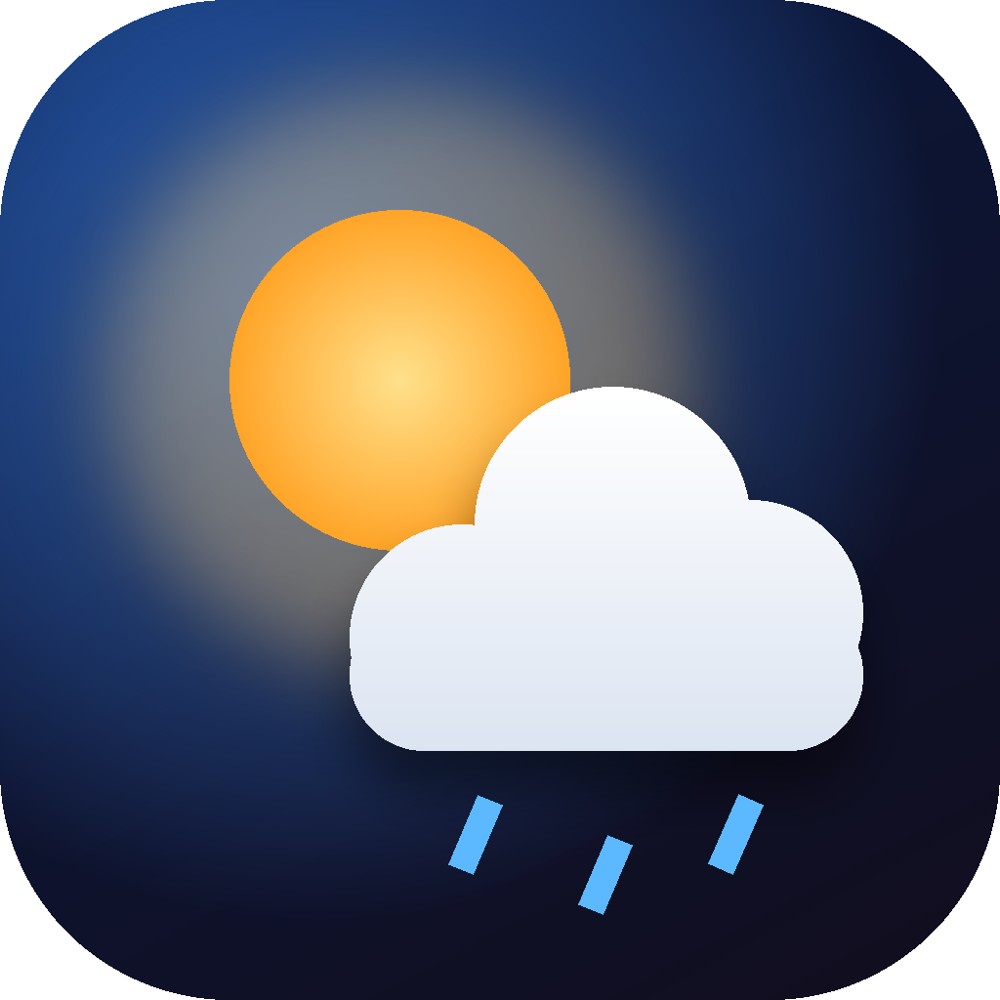
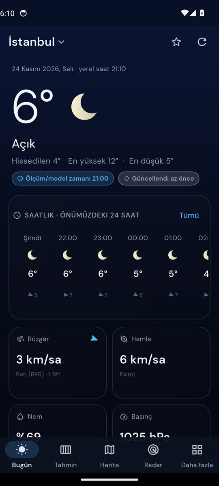
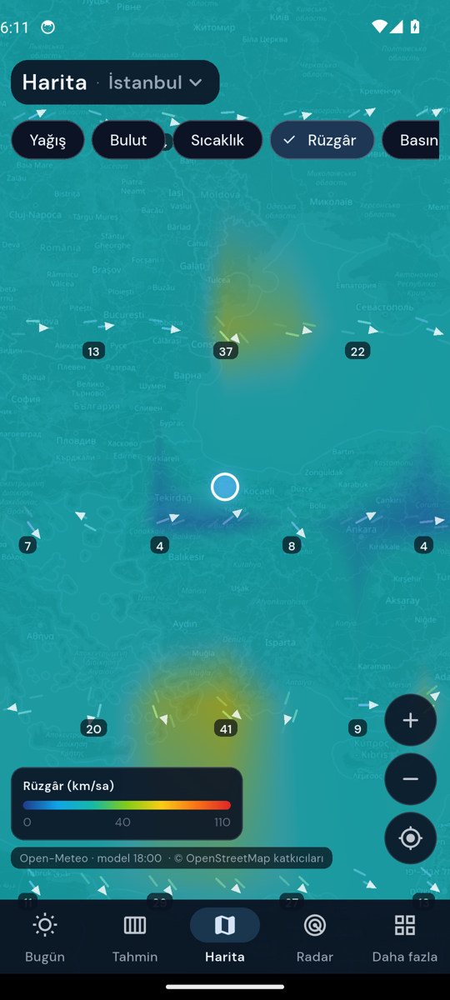
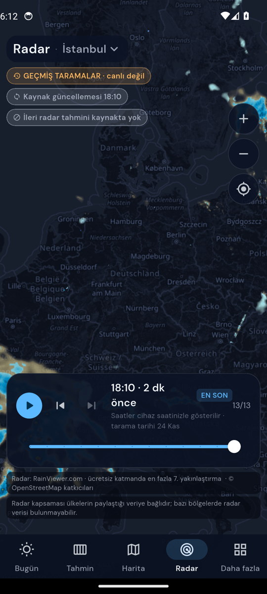
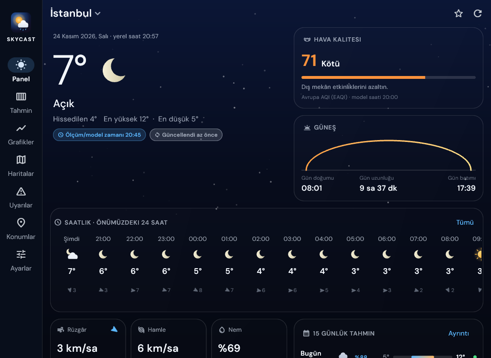

<div align="center">



# SKYCAST

**Türkçe, koyu temalı, gerçek veriyle çalışan hava durumu uygulaması — Android ve Windows**

[](https://github.com/furkantr1923/skycast/actions/workflows/build.yml)


</div>

<p align="center">
  
  
  
</p>
<p align="center">
  
</p>

> Ekran görüntüleri, CI'da derlenen gerçek uygulamanın gerçek verilerle (İstanbul)
> çalıştırılmasıyla otomatik alınır. Hiçbiri tasarım taslağı ya da sahte veri değildir.

## Özellikler

| | Android (gelişmiş) | Windows (sade) |
|---|:---:|:---:|
| Anlık durum: sıcaklık, hissedilen, en yüksek/düşük, nem, basınç, rüzgâr + yön + hamle, Beaufort, UV, görüş, çiy noktası, bulut, gün doğumu/batımı, yağış miktarı ve olasılığı | ✅ | ✅ |
| Saatlik (72 sa) ve 15 günlük tahmin, gün gün güvenilirlik etiketi | ✅ | ✅ |
| Etkileşimli grafikler (sıcaklık, hissedilen, yağış, olasılık, rüzgâr, hamle, nem, basınç, UV) | ✅ | ✅ |
| Meteorolojik haritalar: yağış, bulut, sıcaklık, rüzgâr (animasyonlu), basınç, uydu | ✅ | ✅ |
| Haritaya dokununca o noktanın hava durumu ve "bu konumu seç" | ✅ | ✅ |
| Animasyonlu yağış radarı (geçmiş kareler, oynat/duraklat, zaman çizelgesi) | ✅ | ✅ |
| Uydu: 4 katman, son 2/6/24/72 saat geçmiş kareler, bulut hareketi animasyonu | ✅ | ✅ |
| Ayrıntılı rüzgâr ekranı (pusula, saatlik değişim, Beaufort tablosu) | ✅ | Panelde |
| Hava kalitesi (yalnızca AQI; Avrupa/ABD ölçeği) | ✅ | Panelde |
| Uygulama içi uyarılar + uyarı geçmişi (bildirim yok) | ✅ | ✅ |
| GPS, küresel şehir arama, sınırsız ve sıralanabilir favoriler | ✅ | ✅ |
| Hava durumuna ve gece/gündüze göre atmosferik arka plan | ✅ | ✅ |

Hesap yok, reklam yok, bildirim yok, arka plan servisi yok. Arayüz yalnızca
Türkçe, tema yalnızca koyu. Birimler sabittir: °C, km/sa, mm, hPa.

## Dürüstlük ilkeleri

- **Veri uydurulmaz.** Kaynakta olmayan değer "—" ya da "veri yok" olarak görünür;
  boş tahmin günleri doldurulmaz; ekran görüntüleri gerçek veridir.
- **İnternet yoksa eski veri gösterilmez.** Uygulama Türkçe bağlantı uyarısı ve
  "Yeniden dene" gösterir (CI'da gerçek bir bağlantı hatasıyla sınanır).
- **Radar canlı gibi sunulmaz.** Her karede gerçek tarama saati ve "kaç dk önce"
  yazar; kaynak ileri tahmin vermediği için tahmin karesi gösterilmez.
- **Resmî uyarı ile uygulama göstergesi karıştırılmaz.** MeteoAlarm'dan gelenler
  "RESMÎ UYARI", eşiklerden hesaplananlar "UYGULAMA GÖSTERGESİ · resmî değil" etiketlidir.
- **15 günlük tahmin**, kısa vadeli tahminle aynı güvenilirlikte gösterilmez.

Ayrıntılar ve tüm kaynakların lisans/kota bilgileri: **[docs/API_SAGLAYICILARI.md](docs/API_SAGLAYICILARI.md)**

## İndir

[**Releases**](https://github.com/furkantr1923/skycast/releases) sayfasında:

- `SKYCAST-Setup-1.0.0.exe` — Windows kurulum sihirbazı
- `SKYCAST-Windows-1.0.0-portable.zip` — kurulumsuz Windows sürümü
- `SKYCAST-1.0.0.apk` — Android (7.0+)

Kurulum ve derleme: **[docs/KURULUM.md](docs/KURULUM.md)**

## Mimari

```
lib/
├── app/            tema (tasarım sistemi), kök widget, platform ayrımı
├── core/           hata türleri, HTTP istemcisi, süreli önbellek, Türkçe biçimlendirme
├── domain/         saf modeller: tahmin, yer, uyarı, rüzgâr/Beaufort, AQI, güvenilirlik, uyarı motoru
├── data/
│   ├── providers/  her veri kaynağı için bağımsız istemci (değiştirilebilir)
│   ├── storage/    favoriler, ayarlar, uyarı geçmişi (yerel)
│   └── weather_repository.dart   tek giriş noktası + önbellek
├── services/       GPS
├── state/          AppController (ChangeNotifier) + Load<T> durum modeli
├── ui/             kabuk (Android alt menü / Windows yan menü), ekranlar, haritalar, bileşenler
└── capture/        CI öz-sınama ve ekran görüntüsü modu
```

- **Sağlayıcı soyutlaması:** her kaynak ayrı sınıftır; biri çökerse yalnızca ilgili
  özellik "kullanılamıyor" olur, uygulama çalışmaya devam eder.
- **Saat dilimleri:** tüm zamanlar konumun yerel saatiyle (Open-Meteo `utc_offset`)
  gösterilir; cihazın saat diliminden bağımsızdır.
- **Performans:** sekmeler ilk açılışa kadar oluşturulmaz, radar/uydu yalnızca
  seçili ve sonraki kareleri yükler, görüntü önbelleği sınırlıdır, arka plan
  animasyonu kapatılabilir; hiçbir zamanlayıcı/yoklama yoktur.
- **Bağımlılıklar:** `dio`, `flutter_map` + `latlong2`, `fl_chart`, `geolocator`,
  `shared_preferences`, `url_launcher`, `intl`. Simgeler bağımlılıksız, vektör olarak çizilir.

## Test

```bash
flutter test
```

- Birim testleri: Open-Meteo ayrıştırma (saat dilimi, eksik değer, boş gün),
  Beaufort/yön, AQI, güvenilirlik, uyarı motoru eşikleri, MeteoAlarm eşleştirme,
  radar (tahmin karesi uydurmama), uydu zaman boyutu.
- Durum testleri: kaynak hatalarının yalıtımı, bağlantı yokken eski verinin
  gösterilmemesi, önbellek/yenile, uyarı geçmişi, favoriler.
- Arayüz testleri: Android ve Windows düzenlerinde panel (taşma denetimi dahil).
- **Uçtan uca:** her derlemede gerçek Windows uygulaması ve Android emülatöründe
  gerçek APK, tüm veri kaynaklarına bağlanarak sınanır (`builds` dalında rapor).

## Lisans

Kaynak kod [MIT](LICENSE). Veriler kendi lisanslarına tabidir (bkz. Hakkında
ekranı ve [docs/API_SAGLAYICILARI.md](docs/API_SAGLAYICILARI.md)). DM Sans yazı
tipi SIL Open Font License 1.1 ile dağıtılır.

---

<div align="center"><sub>SKYCAST — Furkan</sub></div>
